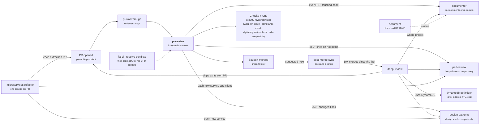

# Claude Code skills

27 [Claude Code](https://claude.com/claude-code) skills that take code from pull request to merge, check it for security, compliance and accessibility, and build, port or test software along the way. They are checked out at `~/.claude/skills`, so Claude Code loads them in every project.

- **Invoke** a skill by name as a slash command (`/pr-review 30`, `/owasp-top10 --fix`), or let Claude pick it when a request matches its description.
- **Change** a skill through a pull request: a separate agent reviews it, [CI](#checks) validates every skill, and it is squash-merged to `master`.
- **Catalogue:** the owner keeps the same content in a private Claude doc, updated whenever a skill is added or changed.
- **Efficiency:** [efficiency.md](efficiency.md) lists the rules that keep token use down without relaxing any gate.

## Skills at a glance

| Skill | What it does | Use when | Arguments |
|---|---|---|---|
| [`pr-review`](pr-review/SKILL.md) | Takes a PR to merged: independent review (with `design-patterns` and `perf-review` checks on 250+ line PRs), fixes with tests, doc comments on touched code (`documenter`), security checks, findings table, green CI, squash-merge | Reviewing and merging a PR | PR number, `--no-merge`, `--max-findings N` |
| [`pr-walkthrough`](pr-walkthrough/SKILL.md) | One PR comment for reviewers: changes by area, sequence diagram, risk score, linked-issue check | Summarising or explaining a PR | PR number, `--no-post`, `--no-diagram` |
| [`fix-ci`](fix-ci/SKILL.md) | Gets failing checks green by fixing the real cause; tells real failures from watcher errors and local-only gaps; never weakens a check | CI is red | PR number, `--default-branch`, `--max-attempts N`, `--report-only` |
| [`resolve-conflicts`](resolve-conflicts/SKILL.md) | Merges the base into a PR and resolves conflicts by keeping both sides' intent | A PR is out of date or conflicting | PR number, `--report-only` |
| [`post-merge-sync`](post-merge-sync/SKILL.md) | After a merge: design doc and diagram, merged-PR counter, linked-repo follow-ups, branch cleanup | Right after a merge | PR number, `--dry-run`, `--no-docs`, `--no-cleanup` |
| [`pr-triage`](pr-triage/SKILL.md) | Ranks open PRs across repos, batches Dependabot PRs, proposes stale PRs for closing, cleans branches | Tidying open work | repos, `--all`, `--apply`, `--stale-days N` |
| [`review-guidelines`](review-guidelines/SKILL.md) | Keeps a repo's review rules so reviews remember settled decisions | "Stop flagging X", "learn from PR N" | `add "RULE" [--scope GLOB]`, `learn [PR]`, `list`, `prune` |
| [`owasp-top10`](owasp-top10/SKILL.md) | Whole-codebase audit against the OWASP Top 10 (2025), with fixes | A security audit of a project | path, `--fix`, `--out FILE` |
| [`owasp-llm-top10`](owasp-llm-top10/SKILL.md) | Audits LLM and agent code against the OWASP LLM (2026) and Agentic (2026) Top 10s, plus MCP server and client checks | Code with prompts, models, tools, MCP or RAG | path, `--diff`, `--fix`, `--out FILE` |
| [`compliance-check`](compliance-check/SKILL.md) | SOX, PII security controls and PCI DSS v4.0.1, with a masked lead scanner | Personal, payment or financial data | path, `--diff`, `--frameworks`, `--fix`, `--out FILE` |
| [`digital-regulation-check`](digital-regulation-check/SKILL.md) | GDPR, ePrivacy, DMA, DSA, AI Act and similar laws, with a tracker scanner | Consent, tracking, user rights, AI decisions, EU users | path, `--diff`, `--laws`, `--fix`, `--out FILE` |
| [`ada-compatibility`](ada-compatibility/SKILL.md) | WCAG 2.2 AA review and fixes for web and mobile UIs, with axe tests | Any UI change | path, `--diff`, `--fix`, `--out FILE` |
| [`secret-history-scan`](secret-history-scan/SKILL.md) | Scans a repo's whole git history for committed secrets, values masked | Before going public, after a leak | repo, `--include-pr-refs`, `--reflog`, `--verify`, `--out FILE` |
| [`deep-review`](deep-review/SKILL.md) | Whole-codebase review: correctness, performance, duplication, readability, security, resilience; design through `design-patterns`, performance through `perf-review`, doc comments through `documenter`, DynamoDB through `dynamodb-optimizer` | 10 or more PRs merged since the last one | path, `--report-only`, `--focus`, `--out FILE` |
| [`test-gen`](test-gen/SKILL.md) | Raises coverage to the target with behaviour-checking tests, proved by mutation | Coverage below 95% | path, `--target`, `--diff`, `--no-mutation` |
| [`resiliency`](resiliency/SKILL.md) | Retries with backoff and jitter, token-bucket and concurrency limits, timeouts | Services calling each other | path, `--retries-only`, `--limits-only`, `--report-only` |
| [`microservices-refactor`](microservices-refactor/SKILL.md) | Finds service boundaries (split now, later or never, with reasons), plans extractions, and extracts one service per PR with Strangler Fig and branch by abstraction; runs `design-patterns` on each new service and seam, and `perf-review` on each new service and client | Splitting a monolith or reviewing service boundaries | path, `--report-only`, `--service NAME`, `--out FILE` |
| [`design-patterns`](design-patterns/SKILL.md) | Finds design smells with `file:line` evidence and fixes them with the right Gang of Four pattern, modern Java idiom or a simpler design; flags pattern overuse; refactors in small tested steps | Reviewing or refactoring a design: a PR (pr-review runs it on 250+ line PRs), a module, or a whole project | path, `--diff [base]`, `--report-only`, `--fix`, `--out FILE` |
| [`perf-review`](perf-review/SKILL.md) | Finds hot paths, then inefficiencies with `file:line` evidence (N+1 calls, scans, unbounded memory, per-request clients, sequential calls, blocking, logging and payload cost), estimates each cost in numbers, proves it with JMH, JFR, async-profiler or a load test, and fixes in small tested steps | Making code faster or leaner: a PR (pr-review runs it on 250+ line PRs that touch request paths, data access or loops), a module, or a whole project | path, `--diff [base]`, `--report-only`, `--fix`, `--focus`, `--out FILE` |
| [`dynamodb-optimizer`](dynamodb-optimizer/SKILL.md) | Inventories every DynamoDB table (keys, GSIs and LSIs, projections, TTL, streams, readers and writers) and access pattern, then finds scans that should be queries, filters that should be sort-key conditions, unused or over-projected indexes, hot keys, ignored pagination, dropped batch items, races without conditions, needless transactions or strong reads and wrong TTL types; estimates RCU and WCU cost and fixes in small tested steps, listing irreversible schema changes for approval | Projects that use DynamoDB: deep-review runs it (not run on PRs), or a direct DynamoDB review | path, `--report-only`, `--fix`, `--focus`, `--out FILE` |
| [`document`](document/SKILL.md) | External docs: per-file and per-function pages in `docs/` plus a project summary merged into the README; re-runs update only changed pages and remove orphans; `--inline` hands source comments to `documenter` | Documenting a codebase outside the source | path, `--inline`, `--out DIR`, `--full` |
| [`documenter`](documenter/SKILL.md) | In-source doc comments: a Javadoc-style comment on every class and on every method over 10 lines of code or public API a reader needs; standardises loose comments, fixes stale ones, changes comment lines only (proved by a bundled comment-only check). Java first; KDoc, PEP 257, TSDoc/JSDoc, Go | "Add javadoc", "comment the code"; pr-review runs it on every PR, deep-review on the whole project | path, `--diff [base]`, `--report-only`, `--check`, `--min-lines N` |
| [`mcp-builder`](mcp-builder/SKILL.md) | Builds MCP servers and clients with an end-to-end test | Exposing a tool to Claude over MCP | what to wrap, `--lang`, `--plain-sdk`, `--http`, `--server-only`, `--client-only` |
| [`javatopython-converter`](javatopython-converter/SKILL.md) | Ports a Java project to idiomatic Python in a new repo, with the full process, then hands it to `port-parity` | Converting Java to Python | path, `--name`, `--dir`, `--public`, `--module`, `--no-merge` |
| [`port-parity`](port-parity/SKILL.md) | Keeps a port in step with its source through golden files and a reviewed PR | Syncing a project and its port | `--source`, `--target`, `--since`, `--report-only` |
| [`token-efficiency-review`](token-efficiency-review/SKILL.md) | Measures where tokens went since the last review (main session, agents, tools, polling, compactions) from local transcripts, printing only numbers and names, and proposes rule and skill changes through a reviewed PR | About every 10 days (scheduled, report-only), or when reviewing token use | `--since`, `--report-only` |
| [`emulator-fidelity`](emulator-fidelity/SKILL.md) | Finds where AWS Emulator differs from AWS and files one issue per confirmed difference; re-checks the user's open issues and closes the fixed ones | Finding, reporting or re-checking emulator gaps | services, `--cap N`, `--report-only`, `--version V`, `--recheck` |

## Pull request lifecycle

Seven skills carry a change from an open PR to merged and tidied, so no step depends on who opened it.

- **pr-walkthrough** writes the reviewer's map of a PR as one comment, updated in place: changes by area, behaviour and breaking changes, a Mermaid sequence diagram when a call flow changed, a risk and effort score, and each linked-issue criterion marked met, partial or not met. It describes; it never judges.
- **pr-review** is the merge gate. A separate agent reviews the diff (and, on PRs of 250 or more changed lines, runs `design-patterns --diff`, plus `perf-review --diff` when they touch request paths, data access or loops); confirmed problems are fixed with tests; `documenter --diff` brings doc comments on the touched code up to date on every PR (a Low finding, always fixed, in its own commit); `security-review` always runs, plus `owasp-llm-top10`, `compliance-check`, `digital-regulation-check` and `ada-compatibility` when their triggers apply. It posts a findings table, waits for green CI, and squash-merges. It never merges with an open Critical, High or Medium finding.
- **fix-ci** reads failed job logs, classifies the failure (test, build, dependency bump, coverage, flaky, infrastructure, workflow, secrets, a renamed required check), separates it from what only looks red (a gh network error, Docker tests skipped locally), reproduces it and fixes the cause, within an attempt limit. It never skips tests, lowers gates or drops required checks.
- **resolve-conflicts** merges the base into the branch (never rebase or force-push), resolves each file from both sides' intent, regenerates lockfiles and generated files with their tools, then builds and tests to catch semantic conflicts. It asks when intent is unclear.
- **post-merge-sync** does the follow-up a merge leaves: the design doc and system diagram, the merged-PR counter that starts `deep-review` once 10 or more PRs have merged since the last one, linked-repo backlog items, and branch and worktree cleanup with uncommitted work archived first.
- **pr-triage** ranks open work across repos (red CI and security first), runs Dependabot PRs through `pr-review` one at a time, and proposes duplicate or abandoned PRs for closing. It only plans unless told `--apply`.
- **review-guidelines** keeps `.claude/review-rules.md`, the decisions reviews should remember. Rules never suppress a Critical, High, security, compliance or accessibility finding, and every rule change goes through a reviewed PR.

## Security, compliance and accessibility

Six skills check code against named standards, each with `file:line` evidence, a severity and a fix; most run on a PR's diff (`--diff`) or a whole project, and apply fixes with `--fix`.

- **owasp-top10** audits a whole codebase against every OWASP Top 10 (2025) category, writes a report, and with `--fix` applies and verifies fixes with the project's build, tests and live checks. Reports for public repos go outside the working tree.
- **owasp-llm-top10** covers LLM and agent code against the OWASP Top 10 for LLM Applications (2026) and for Agentic Applications (2026): prompts, model calls, guardrails, tools, MCP and A2A endpoints, agent memory, RAG. Its MCP checks (token audience and passthrough, Origin and DNS rebinding, confused deputy, tool poisoning, untrusted annotations) are where `mcp-builder` sends security audits.
- **compliance-check** checks SOX (change control, segregation of duties, audit trails, exact money arithmetic), PII security controls and PCI DSS v4.0.1. Its bundled scanner finds SSNs, card numbers and sensitive fields in logs, printing only masked values.
- **digital-regulation-check** covers GDPR and ePrivacy, the DMA, DSA, AI Act, Data Act, Accessibility Act, CRA, NIS2 and DORA, plus CCPA and other regions' laws. Its tracker scanner finds cookies, client storage and third-party scripts loaded before consent.
- **ada-compatibility** reviews and fixes web and mobile UIs to WCAG 2.2 AA, with axe and keyboard tests. The first change to a project with a UI fixes the existing UI too and records a baseline. It never uses accessibility overlays.
- **secret-history-scan** scans every branch, tag and PR ref of a repo's history for committed secrets, with gitleaks, trufflehog or its own scanner. Values are always masked, a liveness check runs only with approval and only against the issuer, and rotation comes before any history rewrite.

## Code quality and engineering

Nine skills improve a codebase's code, design, performance or documentation rather than one change, each in small steps verified by the project's own build and tests.

- **deep-review** reviews an entire codebase (never a PR) for correctness bugs, performance, duplication, readability, a security recheck, and resilience to failing dependencies, and fixes what it proves; it runs `dynamodb-optimizer` (when the project uses DynamoDB), `perf-review`, `design-patterns` and `documenter` (last) for those parts, each in its own subagent and commit, and reports one findings table on the `pr-review` severity scale. It runs once 10 or more PRs have merged since the last one (`post-merge-sync` starts it) and ships as its own PR.
- **test-gen** raises unit-test coverage to the target (95% by default) with tests that assert real outcomes, ranks gaps by risk, and proves the new tests catch mutations. It never lowers a gate or adds exclusions to reach the number.
- **resiliency** adds retries with exponential backoff and jitter on recoverable errors to every service-to-service call, token-bucket and concurrency limits that answer 429 or 503 with `Retry-After`, and timeouts on every outbound call, each proved by a test that simulates the failure.
- **microservices-refactor** maps a codebase's modules, data, call graph and shared tables, recommends which candidates to split now, later or never (with "don't split" cases flagged), plans each extraction (contract, data move, sagas and outbox, rollback), and extracts one service per PR through branch by abstraction behind a flag (usually four PRs: seam, service, remote client, cut-over with removal), with contract tests, service-to-service auth, the `resiliency` checks, and `design-patterns` and `perf-review` passes on each new service.
- **design-patterns** finds design smells (type switches, copied algorithm skeletons, telescoping constructors, hard-wired dependencies, god classes, primitive obsession, anemic models, leaking external APIs, flag-soup state, nulls, shared mutable state, missing test seams) and fixes each with the simplest design that removes it: a Gang of Four or enterprise pattern, a modern Java idiom (records, sealed types with pattern-matching `switch`, lambdas, constructor injection), or less code. It flags pattern overuse and speculative abstraction, says "no pattern needed" when that is the answer, rates findings on the pr-review scale (Medium only when the design blocks safe change or testing, or invites bugs), and with `--fix` refactors in small behaviour-preserving steps behind characterisation tests. `pr-review`, `deep-review` and `microservices-refactor` call it.
- **perf-review** finds hot paths first (request entry points, per-request code, loops over data, schedulers) and judges cost × frequency, so cold code isn't flagged. It finds N+1 calls and queries, scans on request paths, unbounded memory and caches, expensive objects built per request, sequential calls that could run in parallel, blocking on event-loop or pinned threads, chatty calls, missing connection reuse, logging and serialisation cost and large payloads, each with `file:line` evidence and a cost estimate in numbers; proves claims with JMH, JFR, async-profiler or a k6 or Gatling load test; and with `--fix` makes small behaviour-preserving changes, each with a test and, where practical, a measured gain. Java, Spring Boot and DynamoDB first-class, with SQL, Python, Node and front-end checks. Timeouts, retries and limits stay with `resiliency`. `pr-review`, `deep-review` and `microservices-refactor` call it.
- **dynamodb-optimizer** reviews how a codebase uses DynamoDB: it inventories tables from IaC and table-creation code and every access pattern from the code, matches them, and finds correctness bugs (pagination ignored, unprocessed batch items dropped, read-modify-write without a condition, non-idempotent retries) and cost (scans and filters doing a key's job, unused or `ALL`-projected GSIs, LSIs where a GSI fits, hot partition keys, strong reads and transactions that aren't needed, large items, TTL in milliseconds or not enabled, expired items still served). Each finding has an RCU or WCU estimate; fixes come with DynamoDB Local, Testcontainers or request-shape tests; dropping an index or changing a key waits for approval. `deep-review` runs it in its own subagent (area 4), where it commits on the review branch and returns its inventory and findings; `pr-review` does not.
- **document** writes external docs: one page per source file in `docs/` covering its purpose and every function, plus a project summary merged into the README. Each page records its source and commit, so a re-run rewrites only pages whose source changed, moves or deletes pages for renamed or deleted files, and leaves hand-written pages alone (`--full` rebuilds everything); large codebases are split into one subagent per module. Its `--inline` option hands in-source comments to `documenter`.
- **documenter** owns in-source doc comments: a class comment on every class, interface, record and enum (role, collaborators, invariants, thread safety) and a method comment on every method over 10 lines of code (`--min-lines N`) and on public API a reader needs (what and why, `@param`, `@return`, `@throws`, side effects, edge cases). It matches the project's house style, converts loose `//` blocks to the standard format, fixes or removes stale comments, never writes a claim it didn't check, and changes comment lines only, proved by a bundled check (comments stripped and code compared per language, Python syntax trees, directive comments, new files, renames), a build and the touched modules' tests. Under a caller it expects a clean tree, commits only and returns that caller's format. Java first-class, with Kotlin KDoc, Python PEP 257, TypeScript TSDoc, JavaScript JSDoc and Go doc comments. `pr-review` runs it with `--diff` on every PR (except Dependabot and docs-only), `deep-review` on the whole project.

## Building, porting and emulator testing

Four skills create new software or keep two codebases, or an emulator and the real service, in step.

- **mcp-builder** scaffolds MCP servers and clients: Spring Boot with Spring AI by default, or the plain Java SDK, Python or TypeScript, over stdio or Streamable HTTP (OAuth 2.1 and Origin checks for remote servers). Each comes with an end-to-end test that launches the real server and a README of run and connect commands.
- **javatopython-converter** ports a Java project (Maven or Gradle, Spring, MCP, CLIs, libraries) to idiomatic, behaviour-equivalent Python in a new IntelliJ project and GitHub repo, through the full process: PRs only, a 95% coverage gate, CodeQL and scanning, Dependabot, branch protection, golden-file parity tests, and every PR through `pr-review` and `post-merge-sync`; it records the parity baseline so `port-parity` keeps the port in step afterwards. Renamed from `javatopython_converter` in PR #19.
- **port-parity** keeps a port in step with its source: it lists source changes since the parity baseline that alter the shared contract, re-captures golden files from the source build, ports the intended changes in a reviewed PR, and records the new baseline.
- **emulator-fidelity** finds where AWS Emulator differs from the real AWS service. It verifies and extracts the newest release without installing it, checks AWS's documented limitations and known-gaps list first, and probes on at most two private, lightly loaded emulators (never memory-capped or filled). Each confirmed difference becomes one public issue with AWS's docs linked and a repro, filed after the user approves the first draft and within a cap. `--recheck` re-runs the user's open issues on the newest release, closes only the verified-fixed ones with a version comment, and leaves partly fixed and still-broken ones open. Built from the session that filed 27 issues on `aws/aws-emulator`.

## How the skills work together



`pr-review` is the one gate every change passes: it fixes red CI and conflicts the way `fix-ci` and `resolve-conflicts` do, and runs the checks that apply. After the merge it suggests `post-merge-sync` (run it, or ask for it); that skill counts merges and starts `deep-review` once 10 or more have merged since the last one, and the deep review comes back as its own PR. Around this loop, `pr-triage` runs Dependabot PRs through `pr-review` one at a time, `review-guidelines` supplies the rules `pr-review` and `deep-review` read, `test-gen` is run when coverage falls short, and `post-merge-sync` flags port drift for `port-parity`. `design-patterns` is the design check that `pr-review` (on PRs of 250 or more changed lines), `deep-review` and `microservices-refactor` each run; `perf-review` is the performance check they run the same way (in `pr-review`, on 250+ line PRs that touch request paths, data access or loops). `dynamodb-optimizer` runs only inside `deep-review`, on projects that use DynamoDB. `documenter` keeps doc comments current: `pr-review` runs it on every PR's touched code, `deep-review` on the whole project, and `document --inline` hands to it. Dashed lines are suggested or borrowed steps, not automatic calls.

## Checks

Every pull request to this repo must pass these checks before it can merge; `master` is protected and requires them.

| Check | What it enforces |
|---|---|
| Validate skills | Each `SKILL.md` has strict-YAML frontmatter with only upload-accepted keys; `name` equals its folder, uses lowercase letters, digits and hyphens (64 at most) and avoids "claude" and "anthropic"; the description is at most 1024 characters with no `<` or `>`; relative links resolve inside the repo; this README has the skill's row |
| Script tests | Every bundled script's unit tests run under coverage, failing below 95% (98% today) or when a folder of Python code has no `test_*.py` beside it |
| CodeQL | Static analysis of the Python scripts and the workflows |
| Dependency review | Fails a PR that adds a dependency with a high or critical vulnerability |
| Secret scan | Gitleaks on each PR's and push's new commits, and over the whole history weekly and on demand; known false positives are listed by exact fingerprint in `.gitleaksignore`, and two scanners' fake test fixtures are allowlisted by path in `.gitleaks.toml` |

Dependabot keeps the pinned actions and the CI's Python tools current. Run the same checks locally:

```bash
python3 -m pip install -r tools/requirements.txt
python3 tools/validate_skills.py .
tools/run_tests.sh
# one skill's script tests:
python3 -I -m unittest discover -s <skill>/scripts -p 'test_*.py'
```

`templates/` holds files the rules in `~/.claude/CLAUDE.md` tell every project to copy, such as `artifact-cleanup.yml`.

## Change log

Every merged pull request, newest merge first.

| Date | PR | Change |
|---|---|---|
| 2026-11-25 | #PR | Review owasp-llm-top10: LLM Top 10 moved to the 2026 edition (renumbered, Hidden Context Exposure replaces System Prompt Leakage) with a 2025 → 2026 ID map; MCP checks M1–M9 (token passthrough and RFC 8707 audience, Origin and DNS rebinding, confused deputy, tool poisoning, untrusted annotations, rug pulls, state handles, SSRF, tool-call limits) cited to the MCP spec and the OWASP MCP Top 10; pr-review's severity scale with LLM anchors; caller contract, empty-diff and short `--diff` report, report reuse |
| 2026-11-25 | [#49](https://github.com/manojkhanwalkar/claude-skills/pull/49) | Review microservices-refactor: a sign-off rule under autonomy (code-only steps proceed; data, access and outside-the-repo changes still ask); a default four-PR sequence that matches the plan's order (data before traffic); design-patterns and perf-review run on a committed tree with pr-review's severity bar; a "usual mistakes in the code" checklist from real extractions; RFC 9457 typed errors; Dependabot and the full security-check set per extraction |
| 2026-11-25 | [#48](https://github.com/manojkhanwalkar/claude-skills/pull/48) | Review mcp-builder: versions refreshed (Spring AI 2.1.0 on Boot 4.2.0, MCP Java SDK 2.2.0, Python `MCPServer`, TypeScript v2 packages); the 2026-07-28 stateless revision and when to use it, with a `server/discover` smoke test; explicit tool annotations (the defaults are destructive); OAuth 2.1, Origin and limits checklist for HTTP servers, pointing to owasp-llm-top10; coverage and PR flow under the user's rules; javap path fixed |
| 2026-11-25 | [#47](https://github.com/manojkhanwalkar/claude-skills/pull/47) | Review javatopython-converter: deep-review counting deferred to post-merge-sync (code-changing PRs only); security checks run once inside pr-review; self-review for small PRs; changed tests run locally with `--no-cov`; grouped Dependabot updates; compliance checks once the first real code lands; parity baseline and link recorded in both projects' memory and handed to port-parity |
| 2026-11-25 | [#44](https://github.com/manojkhanwalkar/claude-skills/pull/44) | Review dynamodb-optimizer: caller contract (clean tree, start commit, commit only, a return format for deep-review, review-rule Mediums left Open for the caller); Critical severity for cross-user data exposure or loss; DynamoDB Local's always-ACTIVE indexes and strong-looking reads noted for tests; an unsupported SDK retry claim removed |
| 2026-11-25 | [#43](https://github.com/manojkhanwalkar/claude-skills/pull/43) | Review documenter: a tested comment-only check script replaces the grep (which missed new files and lines starting `++`/`--`, and skipped Python directives); caller contract (clean tree, commit only, per-caller return); tool directives and Python runtime docstrings left alone; stale links to removed members; module-by-module large scopes |
| 2026-11-25 | [#42](https://github.com/manojkhanwalkar/claude-skills/pull/42) | Review document: re-runs update changed pages in place and remove orphans (source and commit markers, `--full`); scoped runs edit only their part of OVERVIEW and the README; one subagent per module on large codebases; branch and PR under the user's rules, docs committed before `documenter --inline`; leftover inline-comment guidance removed; function and drift checks in verification |
| 2026-11-25 | [#41](https://github.com/manojkhanwalkar/claude-skills/pull/41) | Review digital-regulation-check: tracker scanner no longer scans the whole tree for an empty diff and scans each file once; `--diff` gives a short report and loads only the touched references; existing reports reused; owns consent, GPC, rights flows and transfers cleanly, leaving WCAG to ada-compatibility; Digital Omnibus status and Colorado's 2026 ADMT law updated |
| 2026-11-25 | [#40](https://github.com/manojkhanwalkar/claude-skills/pull/40) | Review design-patterns: clean-tree check and start commit when called, no push or PR from a caller's branch, a return format for deep-review and pr-review, review-rule Mediums left Open for the caller, hot-spot command completed |
| 2026-11-25 | [#46](https://github.com/manojkhanwalkar/claude-skills/pull/46) | Review fix-ci: flaky random test data fixed without weakening the assertion; gh network errors while watching are not check failures (watch judged from the checks' JSON, retried with backoff); local-only coverage gaps from skipped Docker tests; renamed or added required checks found and fixed in branch protection with agreement |
| 2026-11-25 | [#45](https://github.com/manojkhanwalkar/claude-skills/pull/45) | Review emulator-fidelity: `--recheck` mode for the user's open issues; port-collision guard before a private emulator starts (cleanup could delete the user's folder); one progress signal for background runs; `--version` runs the installed binary on a private port |
| 2026-11-25 | [#39](https://github.com/manojkhanwalkar/claude-skills/pull/39) | Review deep-review: one pr-review severity scale for every area; DynamoDB, performance, design and doc-comment steps in a fixed order, each run in its own subagent and committed separately; baseline from green CI; one findings table; checks owned by the called skills removed |
| 2026-11-25 | [#38](https://github.com/manojkhanwalkar/claude-skills/pull/38) | Review compliance-check: scanner no longer scans the whole tree for an empty diff and scans each file once; `--diff` gives a short report and loads only the touched references; existing reports reused; SAQ A, 6.5.5 test-PAN and SOX evidence commands corrected; consent and transfers point to digital-regulation-check |
| 2026-11-25 | [#37](https://github.com/manojkhanwalkar/claude-skills/pull/37) | Review ada-compatibility: scanner reads Vue modifiers, Thymeleaf and bound attributes, catches paste blocking in every framework, skips test files; `--diff` returns a findings table; stale baselines are flagged |
| 2026-11-25 | [#36](https://github.com/manojkhanwalkar/claude-skills/pull/36) | Add dynamodb-optimizer: inventory DynamoDB tables and access patterns, fix correctness and cost issues (keys, indexes, queries, TTL, transactions) in small tested steps; deep-review runs it, perf-review points to it |
| 2026-11-25 | [#35](https://github.com/manojkhanwalkar/claude-skills/pull/35) | Add documenter: class and method doc comments, standardised and kept current; pr-review runs it on every PR, deep-review on the whole project, document `--inline` delegates to it |
| 2026-11-22 | [#34](https://github.com/manojkhanwalkar/claude-skills/pull/34) | Deep review every 10 merged PRs instead of 5 (rule 5), to spend fewer tokens: post-merge-sync, javatopython-converter, README |
| 2026-11-22 | [#33](https://github.com/manojkhanwalkar/claude-skills/pull/33) | Add perf-review: find hot-path inefficiencies, estimate and measure them, fix in small tested steps; pr-review, deep-review and microservices-refactor call it |
| 2026-11-22 | [#32](https://github.com/manojkhanwalkar/claude-skills/pull/32) | Add design-patterns: find design smells and fix them with the right pattern or a simpler design; pr-review, deep-review and microservices-refactor call it |
| 2026-11-21 | [#31](https://github.com/manojkhanwalkar/claude-skills/pull/31) | Add microservices-refactor: assess service boundaries and extract one service per PR |
| 2026-11-21 | this PR | First token-efficiency review applied: smaller model by default for mechanical agents, one agent per PR, load guides once, read big files by range |
| 2026-11-21 | this PR | Add token-efficiency-review: a 10-day review of token use that proposes rule and skill updates |
| 2026-11-21 | [#28](https://github.com/manojkhanwalkar/claude-skills/pull/28) | Token-efficiency rules (`efficiency.md`) in pr-review, fix-ci, pr-triage, test-gen, post-merge-sync; grouped Dependabot updates |
| 2026-11-21 | [#27](https://github.com/manojkhanwalkar/claude-skills/pull/27) | pr-review: PRs under 250 changed lines get a self-review |
| 2026-11-21 | [#23](https://github.com/manojkhanwalkar/claude-skills/pull/23) | coverage 7.17.3 for CI (Dependabot) |
| 2026-11-21 | [#22](https://github.com/manojkhanwalkar/claude-skills/pull/22) | PyYAML 6.0.3 for CI (Dependabot) |
| 2026-11-21 | [#26](https://github.com/manojkhanwalkar/claude-skills/pull/26) | README rebuilt from the Claude Skills catalogue doc |
| 2026-11-21 | [#20](https://github.com/manojkhanwalkar/claude-skills/pull/20) | Add emulator-fidelity: find and report AWS Emulator differences from AWS |
| 2026-11-21 | [#25](https://github.com/manojkhanwalkar/claude-skills/pull/25) | Secret scan ignores one false positive (a sentence in owasp-top10's reference) |
| 2026-11-21 | [#21](https://github.com/manojkhanwalkar/claude-skills/pull/21) | CI, skill validator, coverage gate, CodeQL, dependency review, secret scanning, after the repo was made public; `master` branch protection turned on after it merged |
| 2026-11-21 | [#19](https://github.com/manojkhanwalkar/claude-skills/pull/19) | Every skill's frontmatter passes strict validation; `javatopython_converter` renamed `javatopython-converter` |
| 2026-11-18 | [#18](https://github.com/manojkhanwalkar/claude-skills/pull/18) | Strict-YAML frontmatter fixed in compliance-check and digital-regulation-check |
| 2026-11-18 | [#17](https://github.com/manojkhanwalkar/claude-skills/pull/17) | Add secret-history-scan, with a standard-library fallback scanner |
| 2026-11-18 | [#16](https://github.com/manojkhanwalkar/claude-skills/pull/16) | Add resolve-conflicts; pr-review uses its approach |
| 2026-11-16 | [#15](https://github.com/manojkhanwalkar/claude-skills/pull/15) | Add fix-ci; pr-review uses it for failing checks |
| 2026-11-16 | [#14](https://github.com/manojkhanwalkar/claude-skills/pull/14) | Add pr-triage |
| 2026-11-16 | [#13](https://github.com/manojkhanwalkar/claude-skills/pull/13) | Add pr-walkthrough; pr-review runs it |
| 2026-11-16 | [#12](https://github.com/manojkhanwalkar/claude-skills/pull/12) | Add review-guidelines; pr-review and deep-review read the rules |
| 2026-11-16 | [#11](https://github.com/manojkhanwalkar/claude-skills/pull/11) | Add test-gen |
| 2026-11-16 | [#10](https://github.com/manojkhanwalkar/claude-skills/pull/10) | Add port-parity |
| 2026-11-16 | [#9](https://github.com/manojkhanwalkar/claude-skills/pull/9) | Add post-merge-sync |
| 2026-11-16 | [#8](https://github.com/manojkhanwalkar/claude-skills/pull/8) | Retire review-agent; its correctness checks move into deep-review |
| 2026-11-15 | [#7](https://github.com/manojkhanwalkar/claude-skills/pull/7) | javatopython-converter: lessons from porting SimpleMCPCalculator |
| 2026-11-15 | [#6](https://github.com/manojkhanwalkar/claude-skills/pull/6) | Add ada-compatibility (WCAG 2.2 AA); pr-review runs it |
| 2026-11-14 | [#5](https://github.com/manojkhanwalkar/claude-skills/pull/5) | Add compliance-check and digital-regulation-check |
| 2026-11-13 | [#4](https://github.com/manojkhanwalkar/claude-skills/pull/4) | Add the artifact-cleanup workflow template |
| 2026-11-13 | [#2](https://github.com/manojkhanwalkar/claude-skills/pull/2) | Add javatopython-converter |
| 2026-11-13 | [#3](https://github.com/manojkhanwalkar/claude-skills/pull/3) | Add deep-review, owasp-llm-top10, pr-review and resiliency |
| 2026-10-26 | [#1](https://github.com/manojkhanwalkar/claude-skills/pull/1) | OWASP Top 10 (2025) audit fixes |

Three skills predate the pull-request process: owasp-top10 and document (2026-10-15, with the since-retired review-agent) and mcp-builder (2026-10-17).
