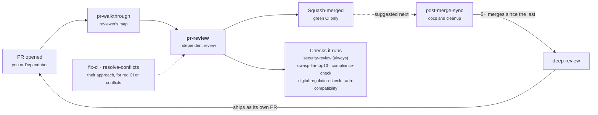

# Claude Code skills

21 [Claude Code](https://claude.com/claude-code) skills that take code from pull request to merge, check it for security, compliance and accessibility, and build, port or test software along the way. They are checked out at `~/.claude/skills`, so Claude Code loads them in every project.

- **Invoke** a skill by name as a slash command (`/pr-review 30`, `/owasp-top10 --fix`), or let Claude pick it when a request matches its description.
- **Change** a skill through a pull request: a separate agent reviews it, [CI](#checks) validates every skill, and it is squash-merged to `master`.
- **Catalogue:** the owner keeps the same content in a private Claude doc, updated whenever a skill is added or changed.

## Skills at a glance

| Skill | What it does | Use when | Arguments |
|---|---|---|---|
| [`pr-review`](pr-review/SKILL.md) | Takes a PR to merged: independent review, fixes with tests, security checks, findings table, green CI, squash-merge | Reviewing and merging a PR | PR number, `--no-merge`, `--max-findings N` |
| [`pr-walkthrough`](pr-walkthrough/SKILL.md) | One PR comment for reviewers: changes by area, sequence diagram, risk score, linked-issue check | Summarising or explaining a PR | PR number, `--no-post`, `--no-diagram` |
| [`fix-ci`](fix-ci/SKILL.md) | Gets failing checks green by fixing the real cause; never weakens a check | CI is red | PR number, `--default-branch`, `--max-attempts N`, `--report-only` |
| [`resolve-conflicts`](resolve-conflicts/SKILL.md) | Merges the base into a PR and resolves conflicts by keeping both sides' intent | A PR is out of date or conflicting | PR number, `--report-only` |
| [`post-merge-sync`](post-merge-sync/SKILL.md) | After a merge: design doc and diagram, merged-PR counter, linked-repo follow-ups, branch cleanup | Right after a merge | PR number, `--dry-run`, `--no-docs`, `--no-cleanup` |
| [`pr-triage`](pr-triage/SKILL.md) | Ranks open PRs across repos, batches Dependabot PRs, proposes stale PRs for closing, cleans branches | Tidying open work | repos, `--all`, `--apply`, `--stale-days N` |
| [`review-guidelines`](review-guidelines/SKILL.md) | Keeps a repo's review rules so reviews remember settled decisions | "Stop flagging X", "learn from PR N" | `add "RULE" [--scope GLOB]`, `learn [PR]`, `list`, `prune` |
| [`owasp-top10`](owasp-top10/SKILL.md) | Whole-codebase audit against the OWASP Top 10 (2025), with fixes | A security audit of a project | path, `--fix`, `--out FILE` |
| [`owasp-llm-top10`](owasp-llm-top10/SKILL.md) | Audits LLM and agent code against the OWASP LLM (2025) and Agentic (2026) Top 10s | Code with prompts, models, tools, MCP or RAG | path, `--diff`, `--fix`, `--out FILE` |
| [`compliance-check`](compliance-check/SKILL.md) | SOX, PII security controls and PCI DSS v4.0.1, with a masked lead scanner | Personal, payment or financial data | path, `--diff`, `--frameworks`, `--fix`, `--out FILE` |
| [`digital-regulation-check`](digital-regulation-check/SKILL.md) | GDPR, ePrivacy, DMA, DSA, AI Act and similar laws, with a tracker scanner | Consent, tracking, user rights, AI decisions, EU users | path, `--diff`, `--laws`, `--fix`, `--out FILE` |
| [`ada-compatibility`](ada-compatibility/SKILL.md) | WCAG 2.2 AA review and fixes for web and mobile UIs, with axe tests | Any UI change | path, `--diff`, `--fix`, `--out FILE` |
| [`secret-history-scan`](secret-history-scan/SKILL.md) | Scans a repo's whole git history for committed secrets, values masked | Before going public, after a leak | repo, `--include-pr-refs`, `--reflog`, `--verify`, `--out FILE` |
| [`deep-review`](deep-review/SKILL.md) | Whole-codebase review: correctness, performance, duplication, readability, security, resilience | 5 or more PRs merged since the last one | path, `--report-only`, `--focus`, `--out FILE` |
| [`test-gen`](test-gen/SKILL.md) | Raises coverage to the target with behaviour-checking tests, proved by mutation | Coverage below 95% | path, `--target`, `--diff`, `--no-mutation` |
| [`resiliency`](resiliency/SKILL.md) | Retries with backoff and jitter, token-bucket and concurrency limits, timeouts | Services calling each other | path, `--retries-only`, `--limits-only`, `--report-only` |
| [`document`](document/SKILL.md) | Per-file and per-function docs plus a project summary merged into the README | Documenting a codebase | path, `--inline`, `--out DIR` |
| [`mcp-builder`](mcp-builder/SKILL.md) | Builds MCP servers and clients with an end-to-end test | Exposing a tool to Claude over MCP | what to wrap, `--lang`, `--plain-sdk`, `--http`, `--server-only`, `--client-only` |
| [`javatopython-converter`](javatopython-converter/SKILL.md) | Ports a Java project to idiomatic Python in a new repo, with the full process | Converting Java to Python | path, `--name`, `--dir`, `--public`, `--module`, `--no-merge` |
| [`port-parity`](port-parity/SKILL.md) | Keeps a port in step with its source through golden files and a reviewed PR | Syncing a project and its port | `--source`, `--target`, `--since`, `--report-only` |
| [`emulator-fidelity`](emulator-fidelity/SKILL.md) | Finds where AWS Emulator differs from AWS and files one issue per confirmed difference | Finding or reporting emulator gaps | services, `--cap N`, `--report-only`, `--version V` |

## Pull request lifecycle

Seven skills carry a change from an open PR to merged and tidied, so no step depends on who opened it.

- **pr-walkthrough** writes the reviewer's map of a PR as one comment, updated in place: changes by area, behaviour and breaking changes, a Mermaid sequence diagram when a call flow changed, a risk and effort score, and each linked-issue criterion marked met, partial or not met. It describes; it never judges.
- **pr-review** is the merge gate. A separate agent reviews the diff; confirmed problems are fixed with tests; `security-review` always runs, plus `owasp-llm-top10`, `compliance-check`, `digital-regulation-check` and `ada-compatibility` when their triggers apply. It posts a findings table, waits for green CI, and squash-merges. It never merges with an open Critical, High or Medium finding.
- **fix-ci** reads failed job logs, classifies the failure (test, build, dependency bump, coverage, flaky, infrastructure, workflow, secrets), reproduces it and fixes the cause, within an attempt limit. It never skips tests, lowers gates or bypasses checks.
- **resolve-conflicts** merges the base into the branch (never rebase or force-push), resolves each file from both sides' intent, regenerates lockfiles and generated files with their tools, then builds and tests to catch semantic conflicts. It asks when intent is unclear.
- **post-merge-sync** does the follow-up a merge leaves: the design doc and system diagram, the merged-PR counter that starts `deep-review` once 5 or more PRs have merged since the last one, linked-repo backlog items, and branch and worktree cleanup with uncommitted work archived first.
- **pr-triage** ranks open work across repos (red CI and security first), runs Dependabot PRs through `pr-review` one at a time, and proposes duplicate or abandoned PRs for closing. It only plans unless told `--apply`.
- **review-guidelines** keeps `.claude/review-rules.md`, the decisions reviews should remember. Rules never suppress a Critical, High, security, compliance or accessibility finding, and every rule change goes through a reviewed PR.

## Security, compliance and accessibility

Six skills check code against named standards, each with `file:line` evidence, a severity and a fix; most run on a PR's diff (`--diff`) or a whole project, and apply fixes with `--fix`.

- **owasp-top10** audits a whole codebase against every OWASP Top 10 (2025) category, writes a report, and with `--fix` applies and verifies fixes with the project's build, tests and live checks. Reports for public repos go outside the working tree.
- **owasp-llm-top10** covers LLM and agent code against the OWASP Top 10 for LLM Applications (2025) and for Agentic Applications (2026): prompts, model calls, guardrails, tools, MCP and A2A endpoints, agent memory, RAG.
- **compliance-check** checks SOX (change control, segregation of duties, audit trails, exact money arithmetic), PII security controls and PCI DSS v4.0.1. Its bundled scanner finds SSNs, card numbers and sensitive fields in logs, printing only masked values.
- **digital-regulation-check** covers GDPR and ePrivacy, the DMA, DSA, AI Act, Data Act, Accessibility Act, CRA, NIS2 and DORA, plus CCPA and other regions' laws. Its tracker scanner finds cookies, client storage and third-party scripts loaded before consent.
- **ada-compatibility** reviews and fixes web and mobile UIs to WCAG 2.2 AA, with axe and keyboard tests. The first change to a project with a UI fixes the existing UI too and records a baseline. It never uses accessibility overlays.
- **secret-history-scan** scans every branch, tag and PR ref of a repo's history for committed secrets, with gitleaks, trufflehog or its own scanner. Values are always masked, a liveness check runs only with approval and only against the issuer, and rotation comes before any history rewrite.

## Code quality and engineering

Four skills improve a whole codebase rather than one change, each in small steps verified by the project's own build and tests.

- **deep-review** reviews an entire codebase (never a PR) for correctness bugs, performance, duplication, readability, a security recheck, and resilience to failing dependencies, and fixes what it proves. It runs once 5 or more PRs have merged since the last one (`post-merge-sync` starts it) and ships as its own PR.
- **test-gen** raises unit-test coverage to the target (95% by default) with tests that assert real outcomes, ranks gaps by risk, and proves the new tests catch mutations. It never lowers a gate or adds exclusions to reach the number.
- **resiliency** adds retries with exponential backoff and jitter on recoverable errors to every service-to-service call, token-bucket and concurrency limits that answer 429 or 503 with `Retry-After`, and timeouts on every outbound call, each proved by a test that simulates the failure.
- **document** writes one doc per source file covering its purpose and every function, plus a project summary merged into the README.

## Building, porting and emulator testing

Four skills create new software or keep two codebases, or an emulator and the real service, in step.

- **mcp-builder** scaffolds MCP servers and clients: Spring Boot with Spring AI by default, or the plain Java SDK, Python or TypeScript, over stdio or Streamable HTTP. Each comes with an end-to-end test that launches the real server and a README of run and connect commands.
- **javatopython-converter** ports a Java project (Maven or Gradle, Spring, MCP, CLIs, libraries) to idiomatic, behaviour-equivalent Python in a new IntelliJ project and GitHub repo, through the full process: PRs only, a 95% coverage gate, CodeQL and scanning, Dependabot, branch protection, golden-file parity tests, and a separate reviewer on every PR. Renamed from `javatopython_converter` in PR #19.
- **port-parity** keeps a port in step with its source: it lists source changes since the parity baseline that alter the shared contract, re-captures golden files from the source build, ports the intended changes in a reviewed PR, and records the new baseline.
- **emulator-fidelity** finds where AWS Emulator differs from the real AWS service. It verifies and extracts the newest release without installing it, checks AWS's documented limitations and known-gaps list first, and probes on at most two private, lightly loaded emulators (never memory-capped or filled). Each confirmed difference becomes one public issue with AWS's docs linked and a repro, filed after the user approves the first draft and within a cap. Built from the session that filed 27 issues on `aws/aws-emulator`.

## How the skills work together



`pr-review` is the one gate every change passes: it fixes red CI and conflicts the way `fix-ci` and `resolve-conflicts` do, and runs the checks that apply. After the merge it suggests `post-merge-sync` (run it, or ask for it); that skill counts merges and starts `deep-review` once 5 or more have merged since the last one, and the deep review comes back as its own PR. Around this loop, `pr-triage` runs Dependabot PRs through `pr-review` one at a time, `review-guidelines` supplies the rules `pr-review` and `deep-review` read, `test-gen` is run when coverage falls short, and `post-merge-sync` flags port drift for `port-parity`. Dashed lines are suggested or borrowed steps, not automatic calls.

## Checks

Every pull request to this repo must pass these checks before it can merge; `master` is protected and requires them.

| Check | What it enforces |
|---|---|
| Validate skills | Each `SKILL.md` has strict-YAML frontmatter with only upload-accepted keys; `name` equals its folder, uses lowercase letters, digits and hyphens (64 at most) and avoids "claude" and "anthropic"; the description is at most 1024 characters with no `<` or `>`; relative links resolve inside the repo; this README has the skill's row |
| Script tests | Every bundled script's unit tests run under coverage, failing below 95% (98% today) or when a folder of Python code has no `test_*.py` beside it |
| CodeQL | Static analysis of the Python scripts and the workflows |
| Dependency review | Fails a PR that adds a dependency with a high or critical vulnerability |
| Secret scan | Gitleaks on each PR's and push's new commits, and over the whole history weekly and on demand; known false positives are listed by exact fingerprint in `.gitleaksignore`, and two scanners' fake test fixtures are allowlisted by path in `.gitleaks.toml` |

Dependabot keeps the pinned actions and the CI's Python tools current. Run the same checks locally:

```bash
python3 -m pip install -r tools/requirements.txt
python3 tools/validate_skills.py .
tools/run_tests.sh
# one skill's script tests:
python3 -I -m unittest discover -s <skill>/scripts -p 'test_*.py'
```

`templates/` holds files the rules in `~/.claude/CLAUDE.md` tell every project to copy, such as `artifact-cleanup.yml`.

## Change log

Every merged pull request, newest merge first.

| Date | PR | Change |
|---|---|---|
| 2026-11-21 | [#20](https://github.com/manojkhanwalkar/claude-skills/pull/20) | Add emulator-fidelity: find and report AWS Emulator differences from AWS |
| 2026-11-21 | [#25](https://github.com/manojkhanwalkar/claude-skills/pull/25) | Secret scan ignores one false positive (a sentence in owasp-top10's reference) |
| 2026-11-21 | [#21](https://github.com/manojkhanwalkar/claude-skills/pull/21) | CI, skill validator, coverage gate, CodeQL, dependency review, secret scanning, after the repo was made public; `master` branch protection turned on after it merged |
| 2026-11-21 | [#19](https://github.com/manojkhanwalkar/claude-skills/pull/19) | Every skill's frontmatter passes strict validation; `javatopython_converter` renamed `javatopython-converter` |
| 2026-11-18 | [#18](https://github.com/manojkhanwalkar/claude-skills/pull/18) | Strict-YAML frontmatter fixed in compliance-check and digital-regulation-check |
| 2026-11-18 | [#17](https://github.com/manojkhanwalkar/claude-skills/pull/17) | Add secret-history-scan, with a standard-library fallback scanner |
| 2026-11-18 | [#16](https://github.com/manojkhanwalkar/claude-skills/pull/16) | Add resolve-conflicts; pr-review uses its approach |
| 2026-11-16 | [#15](https://github.com/manojkhanwalkar/claude-skills/pull/15) | Add fix-ci; pr-review uses it for failing checks |
| 2026-11-16 | [#14](https://github.com/manojkhanwalkar/claude-skills/pull/14) | Add pr-triage |
| 2026-11-16 | [#13](https://github.com/manojkhanwalkar/claude-skills/pull/13) | Add pr-walkthrough; pr-review runs it |
| 2026-11-16 | [#12](https://github.com/manojkhanwalkar/claude-skills/pull/12) | Add review-guidelines; pr-review and deep-review read the rules |
| 2026-11-16 | [#11](https://github.com/manojkhanwalkar/claude-skills/pull/11) | Add test-gen |
| 2026-11-16 | [#10](https://github.com/manojkhanwalkar/claude-skills/pull/10) | Add port-parity |
| 2026-11-16 | [#9](https://github.com/manojkhanwalkar/claude-skills/pull/9) | Add post-merge-sync |
| 2026-11-16 | [#8](https://github.com/manojkhanwalkar/claude-skills/pull/8) | Retire review-agent; its correctness checks move into deep-review |
| 2026-11-15 | [#7](https://github.com/manojkhanwalkar/claude-skills/pull/7) | javatopython-converter: lessons from porting SimpleMCPCalculator |
| 2026-11-15 | [#6](https://github.com/manojkhanwalkar/claude-skills/pull/6) | Add ada-compatibility (WCAG 2.2 AA); pr-review runs it |
| 2026-11-14 | [#5](https://github.com/manojkhanwalkar/claude-skills/pull/5) | Add compliance-check and digital-regulation-check |
| 2026-11-13 | [#4](https://github.com/manojkhanwalkar/claude-skills/pull/4) | Add the artifact-cleanup workflow template |
| 2026-11-13 | [#2](https://github.com/manojkhanwalkar/claude-skills/pull/2) | Add javatopython-converter |
| 2026-11-13 | [#3](https://github.com/manojkhanwalkar/claude-skills/pull/3) | Add deep-review, owasp-llm-top10, pr-review and resiliency |
| 2026-10-26 | [#1](https://github.com/manojkhanwalkar/claude-skills/pull/1) | OWASP Top 10 (2025) audit fixes |

Three skills predate the pull-request process: owasp-top10 and document (2026-10-15, with the since-retired review-agent) and mcp-builder (2026-10-17).
