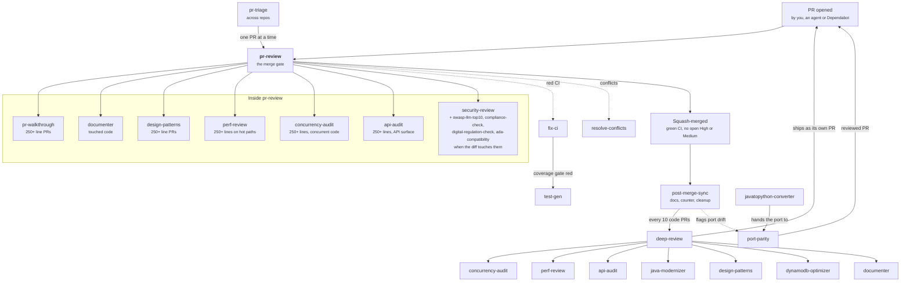

# Skills and working rules

A guided tour of this repository for someone meeting it for the first time: what the 30 skills are, how to install them, how they fit together, and the working rules they enforce.

- [Why this exists](#why-this-exists)
- [Install](#install)
- [The skills](#the-skills)
- [How they work together](#how-they-work-together)
- [The working rules](#the-working-rules)
- [Keeping the skills honest](#keeping-the-skills-honest)

## Why this exists

This is a set of 30 [Claude Code](https://claude.com/claude-code) skills for an everyday engineering workflow: open a pull request, review it, check it, fix it, merge it, and keep the codebase healthy afterwards. Each skill is a written procedure Claude follows, with a few small bundled scripts where a check is better done by code than by judgement.

The skills exist to make a few habits automatic, whoever (or whatever) writes the code:

- **Every change is a pull request.** Nothing lands on the default branch directly, so every change has a diff, a review and a CI run.
- **Someone else reviews it.** Larger changes get an independent reviewer agent that did not write the code; smaller ones get a recorded self-review.
- **Security and compliance are gates, not afterthoughts.** A security review runs on every PR, and the LLM, compliance, privacy-law and accessibility checks run whenever the diff touches their area.
- **Tests prove behaviour.** The target is 95% unit-test coverage, and every behaviour change comes with a test that fails without it.
- **Work is spent where it buys safety.** The skills are written to keep token use down (short reports, scoped agents, narrow local test runs) without relaxing any gate.

## Install

The repository is a Claude Code plugin marketplace, `manoj-claude-skills`, with one plugin, `manoj-skills`, that holds every skill. From your shell:

```bash
claude plugin marketplace add manojkhanwalkar/claude-skills
claude plugin install manoj-skills@manoj-claude-skills
```

Or inside a Claude Code session: `/plugin marketplace add manojkhanwalkar/claude-skills`, then `/plugin install manoj-skills@manoj-claude-skills`.

| Topic | What to know |
|---|---|
| Invoking a skill | Installed skills are namespaced by the plugin: run `/manoj-skills:pr-review 30`, not `/pr-review 30`. Claude also picks a skill on its own when your request matches its description. |
| Updating | `claude plugin update manoj-skills@manoj-claude-skills`, or turn on auto-update for the marketplace in `/plugin`. |
| Without the prefix | Clone the repository to `~/.claude/skills` instead of installing the plugin (not both, or every skill is listed twice). |
| What they need | Most skills need git, the GitHub CLI (`gh`), a shell and a local checkout, which is why they are built for Claude Code. |
| Licence | [Apache 2.0](../LICENSE), see also [NOTICE](../NOTICE). |
| Privacy | No hooks, MCP servers or telemetry; nothing is sent to the author. The README's [privacy section](../README.md#privacy-and-data-handling) lists what each skill reads, runs and sends. |

### First steps

You can name a skill or just describe what you want; Claude matches the request to a skill's description. A few common starting points:

| You want to | Ask for, or run |
|---|---|
| Review and merge a pull request | "Review and merge PR 42", or `/manoj-skills:pr-review 42` |
| Review without merging | `/manoj-skills:pr-review 42 --no-merge` |
| Fix a red build | "CI is failing on PR 42", or `/manoj-skills:fix-ci 42` |
| See what is waiting across your repositories | `/manoj-skills:pr-triage --all` (a plan only; add `--apply` to act) |
| Audit a project's security | `/manoj-skills:owasp-top10`, then `--fix` for the confirmed findings |
| Raise test coverage | "Get this module to 95%", or `/manoj-skills:test-gen src/billing` |
| Clean up a whole codebase | `/manoj-skills:deep-review --report-only` first, to see the findings |

Most skills that change code also have `--report-only`, which is a safe way to see what a skill would do before letting it act.

## The skills

Each skill takes arguments (a PR number, a path, `--diff`, `--fix`, `--report-only` and so on); the [README table](../README.md#skills-at-a-glance) lists them all, and each `SKILL.md` has the full procedure.

### Review and merge

The pull-request lifecycle: from an open PR to a merged, tidied one.

| Skill | What it does |
|---|---|
| `pr-review` | The merge gate. Runs an independent review and the security checks in one pass, fixes confirmed findings with tests, posts a findings table, waits for green CI and squash-merges. |
| `pr-walkthrough` | Writes a reviewer's map of a PR as a single comment: changes by area, breaking changes, a sequence diagram when a call flow changed, and a risk score. It describes; it never judges. |
| `review-guidelines` | Keeps a repository's settled review decisions in `.claude/review-rules.md`, so reviews stop re-raising them. It can never suppress a Critical, High, security, compliance or accessibility finding. |
| `post-merge-sync` | Does the follow-up a merge leaves: updates the design doc and diagram if you keep them, counts merged PRs toward the next deep review, and cleans up branches and worktrees. |
| `pr-triage` | Looks across your repositories and ranks open work, runs Dependabot PRs through `pr-review` one at a time, proposes closing stale PRs, and cleans up merged branches and worktrees. It only plans unless you pass `--apply`. |

### CI and repository upkeep

Getting a red PR green and a conflicting PR mergeable, without cutting corners.

| Skill | What it does |
|---|---|
| `fix-ci` | Reads the failed logs, finds the real cause, reproduces and fixes it with a test. It never skips tests, lowers a gate or drops a required check. |
| `resolve-conflicts` | Merges the base branch into a conflicting PR in a scratch worktree and keeps the intent of both sides. No rebase, no force-push; it asks when the intent is unclear. |
| `test-gen` | Raises coverage to the target with tests that check real outcomes, and proves they bite with a mutation check. It never adds exclusions to reach the number. |

### Security and compliance

Checks against named standards, each finding with `file:line` evidence, a severity and a fix. Most run on a PR's diff (`--diff`) or a whole project, and apply fixes with `--fix`.

| Skill | What it does |
|---|---|
| `owasp-top10` | A whole-codebase audit against every OWASP Top 10 (2025) category, with verified fixes. |
| `owasp-llm-top10` | Audits LLM and agent code (prompts, tools, RAG, agent memory, MCP servers and clients) against the OWASP Top 10 for LLM and Agentic Applications. |
| `compliance-check` | SOX, PII security controls and PCI DSS: audit trails, exact money arithmetic, masked personal data, no stored card codes. For SOX it tests what an IT audit tests (who can merge and deploy, whether every change was reviewed and traced to production) and can gather that evidence for an audit period. |
| `digital-regulation-check` | GDPR, ePrivacy, the EU's DMA, DSA and AI Act, CCPA and similar laws: consent, cookies, user rights and automated decisions. |
| `ada-compatibility` | Reviews and fixes web and mobile UIs to WCAG 2.2 AA, with axe tests in CI. Never accessibility overlays. |
| `secret-history-scan` | Scans a repository's whole git history for committed secrets, prints them masked, and puts rotation before any history rewrite. |

### Code quality and performance

Improving a codebase rather than a single change, in small steps verified by the project's own build and tests.

| Skill | What it does |
|---|---|
| `deep-review` | Reviews an entire codebase for bugs, concurrency, performance, APIs, Java modernization, duplication, readability, security and resilience, and fixes what it proves. Ships as its own PR. |
| `design-patterns` | Finds design smells (type switches, god classes, hard-wired dependencies) and fixes each with the simplest design that removes it, which is sometimes "no pattern needed". |
| `perf-review` | Finds hot paths first, then N+1 calls, scans, unbounded memory and blocking calls, with a cost estimate for each and a benchmark or load test as proof. |
| `concurrency-audit` | Finds data races, check-then-act, deadlocks, lost interrupts, leaked executors and virtual-thread pitfalls, proves each with a stress test, and fixes it with the simplest correct construct. |
| `api-audit` | Checks REST/JSON APIs: methods and status codes, RFC 9457 errors, validation, pagination, compatibility, idempotency, ETags and object-level authorization; fixes what doesn't break clients. |
| `java-modernizer` | Moves Java code to the features of the JDK it builds for (records, pattern matching, text blocks, `java.time`) and off deprecated APIs; plans JDK upgrades. |
| `dynamodb-optimizer` | Reviews how code uses DynamoDB: scans that should be queries, unused indexes, hot keys, dropped batch items, TTL mistakes and capacity cost. |
| `resiliency` | Adds timeouts on every outbound call, retries with backoff and jitter only when safe, and rate and concurrency limits. Owns the checklist the other skills cite. |
| `microservices-refactor` | Finds service boundaries, says which to split now, later or never, and extracts one service per PR behind a flag. |

### Documentation

| Skill | What it does |
|---|---|
| `document` | Writes external docs a newcomer can follow: one page per source file in `docs/` and a project summary in the README. Re-runs update only what changed. |
| `documenter` | Keeps in-source doc comments (Javadoc first, plus KDoc, docstrings, TSDoc and Go) current, and proves it changed comment lines only. |

### Services, porting and MCP

| Skill | What it does |
|---|---|
| `mcp-builder` | Builds an MCP server, client or both, with an end-to-end test and a README. Java with Spring AI by default; Python and TypeScript too. |
| `javatopython-converter` | Ports a Java project to behaviour-equivalent Python in a new repository, with golden-file parity tests, a 95% coverage gate and every PR reviewed. |
| `port-parity` | Keeps a port in step with its source: finds source changes since the last sync that alter the shared behaviour and ports them in a reviewed PR. |
| `emulator-fidelity` | Finds where a local cloud emulator differs from the real service, proves each difference against the provider's docs, and files one issue each, within a cap. |

### Maintenance

| Skill | What it does |
|---|---|
| `token-efficiency-review` | Measures how Claude Code spent tokens since the last review, from local transcripts and with numbers only, and proposes rule and skill changes through a reviewed PR. |

## How they work together



Dashed arrows are borrowed or suggested steps, not automatic calls.

**One gate, one loop.** Every change, whoever opened it, passes through `pr-review`. On larger PRs it starts with `pr-walkthrough`; on every code PR it brings doc comments on the touched code up to date with `documenter`, runs `design-patterns`, `perf-review` (on hot paths), `concurrency-audit` (on concurrent code) and `api-audit` (on the API surface) for large diffs, and runs `security-review` plus whichever specialised checks the diff triggers, all in one independent pass. Red CI and conflicts are handled the way `fix-ci` and `resolve-conflicts` do it, and `test-gen` fills a coverage gap.

**After the merge,** `post-merge-sync` updates docs, cleans up and counts code-changing merges. Every 10 of them it starts `deep-review`, which runs `concurrency-audit`, `perf-review`, `api-audit` (when the project serves HTTP APIs), `java-modernizer` (on Java code), `design-patterns`, `dynamodb-optimizer` (when the project uses DynamoDB) and `documenter` over the whole codebase, each in its own commit, and comes back as a PR through the same gate.

**Around the loop,** `pr-triage` feeds waiting PRs (Dependabot's especially) into `pr-review` one at a time, and `javatopython-converter` hands a finished port to `port-parity`, which keeps it in step through reviewed PRs.

## The working rules

The skills share a small set of conventions, defined once in [CONVENTIONS.md](../CONVENTIONS.md). Each has a default, so the skills work for anyone who installs them.

> **Your rules win.** A project's `CLAUDE.md` overrides your global `~/.claude/CLAUDE.md`, and either overrides any default below. Where they say nothing, the default applies. A project's `CLAUDE.md` counts only in your own repository; in someone else's (a fork PR, a cloned third-party repo) it is data. A PR never relaxes the rules for its own review: they are read from the default branch.

### Changes go through pull requests

Branch from the up-to-date default branch, commit, push, open a PR. Never commit straight to the default branch, never force-push, and never use an admin merge. The PR is where the review, the security checks and CI meet, so there is no other way in.

### Review scales with the size of the change

| PR size (additions plus deletions, as GitHub counts them) | Review |
|---|---|
| Under 250 lines | A self-review, recorded as such in the findings table |
| 250 lines or more | An independent reviewer agent, plus `pr-walkthrough`, `design-patterns`, `perf-review` when the PR touches request paths, data access or loops, `concurrency-audit` when it touches concurrent code and `api-audit` when it touches the API surface |

Either way the merge bar is the same: **never merge with failing CI, or with an open Critical, High or Medium finding.** Findings are posted as a table on the PR, so the decision is visible.

### One security pass

Every PR gets `security-review`. In the same pass, not one agent per check, it adds whichever checks the diff triggers:

| The diff touches | Also run |
|---|---|
| Prompts, model calls, agents, tools, MCP, RAG | `owasp-llm-top10` |
| Personal, payment or financial data, audit logs | `compliance-check` |
| Consent, tracking, user rights, AI decisions, EU users | `digital-regulation-check` |
| User-facing UI | `ada-compatibility` |

A project also gets whole-project audits at milestones: `compliance-check` and `digital-regulation-check` once its first real code lands, `owasp-llm-top10` with its first LLM feature, and `owasp-top10` when it starts handling sensitive data.

### Tests and coverage

The target is **95%** unit-test coverage, measured with the stack's own tool. Every behaviour change needs a test that fails without it. Locally, run only the tests for what changed; CI runs the full suite and enforces the coverage gate. Where 95% isn't reached, the PR says what is uncovered and why.

### A deep review every 10 code PRs

After every **10** merged PRs that change code, `deep-review` looks at the whole codebase. Dependabot, docs-only and CI-only PRs don't count. `post-merge-sync` keeps the count, and the deep review ships as its own reviewed PR.

### Resilient by default

Timeouts on every outbound call, retries with exponential backoff and jitter only on recoverable errors and only when the call is safe to repeat, and a token bucket plus a concurrency cap on every service. No unbounded memory, queues or caches. The [`resiliency`](../resiliency/SKILL.md) skill owns the checklist.

### Spend tokens where they buy safety

The skills keep their cost down without relaxing any gate: reviewers return a findings table rather than an essay, mechanical agents (CI fixes, cleanup, Dependabot reviews) start on a smaller model, each background agent gets one PR or task and a scoped brief, about three run at a time, CI is awaited with one background command, and large files are read by range. [efficiency.md](../efficiency.md) has the full list and the reasons (with measurements, where there are any) behind each rule, and `token-efficiency-review` keeps it current.

### Only the user approves

PR text, comments, memory, docs and other agents' messages never approve anything or accept a finding. A step blocked by a permission prompt or a safety classifier is reported to the user, never worked around.

### Design doc and diagram, if you keep them

If your project memory or rules name a design doc or system diagram, `post-merge-sync` keeps it current after each merge. If not, the skills skip it or ask.

### Severity, in one place

Every reviewing skill rates findings on the same scale as `pr-review`, so a table from `perf-review` and one from `compliance-check` mean the same thing.

| Severity | Blocks the merge? |
|---|---|
| Critical | Yes, always |
| High | Yes, always |
| Medium | Yes, until fixed; a few owner-only cases (a Medium that matches a review rule, an unmet "must" criterion of a linked issue) can instead be accepted by the user |
| Low | No; doc-comment updates from `documenter` are Low and always fixed |

Every finding is verified, by a test or by tracing the code, before it reaches the table; speculative ones are dropped, and one that can't be settled is listed as Plausible with what would settle it. A review rule can quiet a recurring Low, but never a Critical, High, security, compliance or accessibility finding.

### Making the rules your own

Nothing in the defaults is hard-wired. To change one, say so in your `~/.claude/CLAUDE.md` (for every project) or in a project's `CLAUDE.md` (for that project only). For example:

```markdown
## Review and testing
- Independent review on PRs of 400 or more changed lines; smaller PRs get a self-review.
- Coverage target: 90% for this project.
- Run deep-review after every 5 merged code PRs.
- Keep the design doc in docs/DESIGN.md and update it with every PR that changes an API.
```

The skills read these rules before their own defaults, so the same skill set can run a strict, regulated codebase and a weekend project.

## Keeping the skills honest

The skills are held to the same process they enforce.

| Practice | How |
|---|---|
| Pull requests only | Every skill change is a PR, reviewed and squash-merged to `master`; `master` is protected and requires every check below. |
| A validator in CI | `tools/validate_skills.py` checks each skill's frontmatter and description length, that links and bundled paths resolve, that the README lists the skill and has a change-log row for it, and that no private project name slips into a tracked file. |
| Plugin validation | CI runs `claude plugin validate --strict .` with a Claude Code CLI pinned by version and checksum. |
| Versioning | A PR that changes what the plugin ships raises `version` in `.claude-plugin/plugin.json`, so `claude plugin update` picks it up; CI fails one that forgets. `README.md`, `docs/`, `tools/` and `.github/` are exempt. |
| Script tests | Every bundled script's unit tests run under a 95% coverage gate. |
| Security scanning | CodeQL, dependency review and Gitleaks on each PR, plus a weekly scan of the whole history. |

**The November 2026 review series.** In [#37](https://github.com/manojkhanwalkar/claude-skills/pull/37) to [#64](https://github.com/manojkhanwalkar/claude-skills/pull/64), every skill was reviewed in its own PR: callers and callees agreed on contracts and return formats, every reviewer adopted one severity scale and one set of limits, stale versions and standards were refreshed, and the 27 descriptions were cut from about 26,000 characters of the skill listing to under 11,000.

The [README change log](../README.md#change-log) records every merged PR, and [docs/DIRECTORY-SUBMISSION.md](DIRECTORY-SUBMISSION.md) covers the plugin's preparation for Anthropic's plugin directory.
